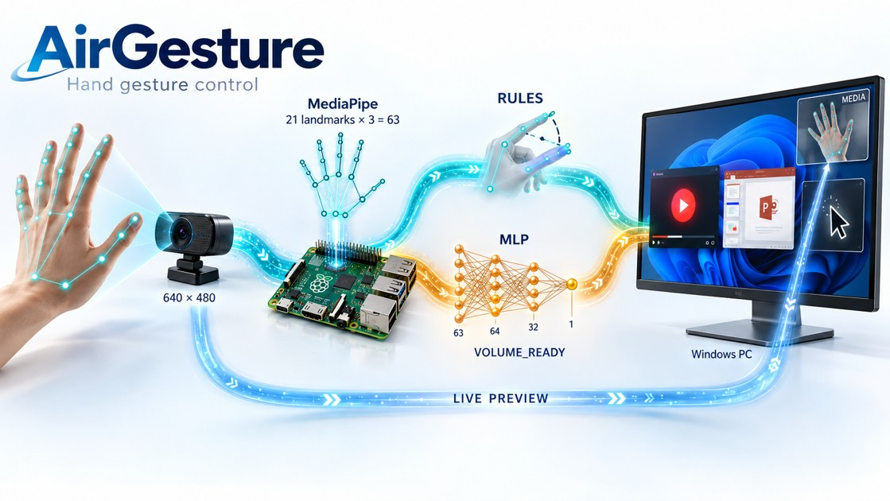

# AirGesture 손동작 제어

USB 웹캠으로 손을 인식하고, Raspberry Pi가 보낸 동작 명령으로 Windows의 YouTube·PowerPoint·마우스를 제어하는 팀 프로젝트입니다. 이 저장소의 실행 구성은 최종 제출본을 기준으로 정리했습니다. 김민준은 손동작 판정에서 PC 앱 실행까지 신호 흐름을 확인하고, 스와이프와 음량 조절이 서로 간섭하는 조건을 디버깅했습니다.



## 입력에서 PC 동작까지

| 단계 | 최종 동작 |
| --- | --- |
| 인식 | MediaPipe의 21개 손 랜드마크로 손 자세를 판정합니다. |
| 음량 준비 | 자세 규칙이 흔들릴 때 63차원 입력의 NumPy MLP 점수로 `VOLUME_READY` 판정을 보강합니다. |
| 스와이프 | MEDIA 또는 PPT에서 OK를 약 0.35초 유지해 시작합니다. 손바닥 중심이 화면 가로 폭의 약 8% 이상 이동하면 명령을 내고, 중앙 복귀 후 다음 동작을 받습니다. |
| Windows 제어 | 명령·상태는 HTTP로 보내고, 미리보기는 JPEG/MJPEG 스트림으로 따로 보냅니다. Edge·Playwright, PowerPoint COM, Windows 마우스 수신기가 각각 동작을 실행합니다. |

| 모드 | 시작과 동작 |
| --- | --- |
| MOUSE | MAIN에서 검지 유지. PC의 F8로 포인터 제어를 켭니다. 검지로 이동, 엄지·검지 핀치로 클릭·드래그, 두 손가락으로 스크롤합니다. |
| MEDIA | MAIN에서 검지·중지 유지. 재생·정지·음량을 제어합니다. 스와이프 중에는 일반 미디어 명령을 잠그며 엄지·검지·새끼를 약 0.4초 유지하면 스와이프가 해제됩니다. |
| PPT | MAIN에서 검지·중지·약지 유지. 스와이프 중 미러 화면 기준 왼쪽 이동은 다음, 오른쪽은 이전 슬라이드입니다. 주먹을 약 0.35초 유지하면 스와이프가 해제됩니다. |

모드에 진입한 뒤 선택 자세를 풀어야 명령을 받습니다. 엄지를 접고 나머지 네 손가락을 유지하면 MAIN으로 돌아갑니다. MOUSE에서 추적이 끊기면 드래그를 해제합니다.

## 실행

### Windows PC

Python, Microsoft Edge, 데스크톱 PowerPoint를 준비합니다.

```powershell
cd windows-pc
Copy-Item desktop_config.example.json desktop_config.json
python -m pip install -r requirements.txt
python server.py
```

`desktop_config.json`의 `youtube_url`을 재생할 영상이나 재생목록 주소로 바꿉니다. 처음 실행할 때 PC가 연결 키를 생성합니다. 제공된 `AIRGESTURE_PC.cmd`로도 실행할 수 있습니다. PPT 모드는 최근 발표 파일을 열며, 발표 모드는 PowerPoint에서 직접 시작합니다.

### Raspberry Pi

```bash
cd raspberry-pi
python -m venv .venv
source .venv/bin/activate
python -m pip install -r requirements-controls.txt
python main.py --camera 0 --no-bridge --no-stream
```

이 명령으로 인식만 확인할 수 있습니다. MediaPipe Hand Landmarker는 첫 실행에서 제공처 모델을 다운로드합니다. Pi–PC 통합 시 Pi에서 `python configure_bridge.py`로 PC 주소와 연결 키를 입력하고 아래 명령을 실행합니다.

```bash
python main.py --camera 0 --headless --fps 30 --preview-fps 25
```

Pi에서 PC로 명령을 보낼 때 TCP **8765**, PC에서 Pi의 미리보기를 받을 때 TCP **8767**을 사용합니다. 이 실행 구성은 신뢰할 수 있는 로컬 네트워크를 대상으로 합니다.

## 모델과 학습 자료

- [음량 자세 모델 및 코드](raspberry-pi/models/volume_ready_mlp.npz) — 21개 랜드마크를 손목 기준으로 정규화해 63개 특성으로 펼칩니다. **63 → 64 → 32 → 1**, 총 **6,209개 파라미터**입니다. [NumPy 추론](raspberry-pi/volume_classifier.py) · [MATLAB 모델 및 데이터 분포 분석](analysis/matlab/README_KO.md)
- [스와이프 수집·학습 실습](training/swipe/) — 녹화 도구, 특성 추출, NumPy 학습 코드, 모델, 분할·평가 기록을 제공합니다. 학습·실험 모듈 테스트 10개를 확인했습니다. 실험 모델은 **1,584 → 64 → 3**으로 left/right/none을 분류했습니다. 최종 앱의 기본 스와이프는 손바닥 수평 변위 방식입니다.

## 검증

| 구분 | 확인 내용 |
| --- | --- |
| 팀 최종 보고서 | 평균 **16.3 fps**, 정지 자세 **98.7%**(3종·4조건·총 75회), 음량 명령 성공률 **75% → 88%**. 발표자료의 측정 범위와 기능 완성도는 [최종 보고서 정리](docs/final-report-notes.md)에 기록했습니다. |
| 이번 게시 검증 | Pi 쪽 기존 테스트의 손목 회전 입력과 OK 종료 기대값을 최종 수평 이동·모드별 해제 동작에 맞춰 갱신했습니다. **55개 테스트 통과**. 실제 Pi 카메라와 Windows 앱의 전체 연동 성능은 현장 조건에서 별도로 측정합니다. |

Pi 쪽 테스트는 `raspberry-pi/`에서 `python -m unittest discover -p "test_*.py"`로 실행합니다. Windows 사용자 프로필, 연결 키, 개인 설정 및 영상은 게시용 소스에서 제외했습니다.
