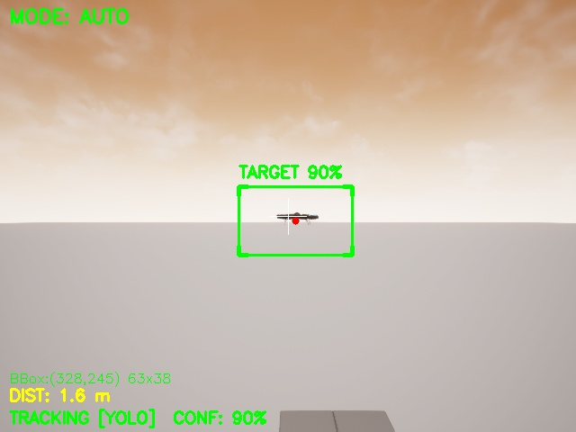

# VC707 FPGA YOLOv5n와 드론 목표 추적

2025년 9월–2026년 6월 캡스톤 디자인입니다. AirSim에서 영상을 캡처해 FPGA 추론 경로로 보내고, 반환된 BBox를 드론 추적에 연결했습니다. AirSim·카메라 환경, PC–FPGA 전송 경로의 통합, BBox 디버깅과 출력 검증용 테스트벤치를 맡았습니다.



## 이 저장소의 소스

기존 통합 패키지는 저장소 루트에 있습니다. 아래 경로는 이 폴더 기준으로 링크했습니다.

| 경로 | 역할 |
| --- | --- |
| [Ethernet / 기존 endpoint](../../rtl/orig_endpoint/) | 수신 UDP payload를 기존 32비트 BRAM-like 쓰기 요청으로 전달 |
| [DDR3 RTL](../../rtl/ddr3/) | 명령 FIFO·중재기, AXI4 single-beat master, GFB DDR3 어댑터 |
| [YOLO RTL](../../rtl/yolo/) | 합성곱, 재양자화, 특징맵 처리, Head 및 BBox 처리 모듈 |
| [PC 도구](../../pc_tools/) | 이미지·AirSim 입력 전송과 별도 readback 디버그 도구 |
| [Vivado 통합 가이드](../../docs/README_KR.md) | 소스 등록, VC707 MIG 설정과 사용자 top 연결 |

```text
AirSim / 이미지 → PC에서 UDP MBWR 데이터 전송
  → VC707 Ethernet endpoint → FIFO / 명령 중재 → AXI4 / MIG → DDR3
  → GFB 어댑터 → YOLO 모듈 / 상위 제어 → BBox → PC 후처리
```

GitHub에 있는 패키지는 DDR3 데이터 경로와 YOLO 모듈의 통합 구성입니다. 동일한 시스템을 구현하려면 VC707 보드 preset의 **MIG 7 Series**, 해당 프로젝트의 YOLO top 제어와 결과 반환 경로를 연결해야 합니다.

## Vivado와 PC에 연결하기

1. VC707 대상 Vivado 프로젝트에서 저장소 루트를 기준으로 `source vivado/add_ddr3_yolo_sources.tcl`을 실행합니다.
2. VC707 DDR3 preset으로 MIG를 구성하고 AXI 데이터 폭을 맞춥니다. 폭이 다르면 변환기를 넣습니다. MIG `ui_clk`, 리셋, `init_calib_complete`를 먼저 확인합니다.
3. 이미지 전송에는 Python, NumPy, OpenCV가 필요합니다. AirSim 직접 캡처에는 AirSim Python 클라이언트와 실행 중인 시뮬레이터가 필요합니다.
4. 저장소 루트에서 실제 보드 IP와 테스트 이미지 경로로 예제 값을 바꿔 전송합니다.

```powershell
python -m pip install numpy opencv-python
python pc_tools/airsim_image_to_ddr3_mbwr.py --fpga-ip 192.0.2.10 --image ./frame.jpg --resize 640x480
```

기본 프레임 헤더는 `0x0000_0000`, 이미지/GFB 데이터는 `0x0000_0100`부터 시작합니다. GFB의 2,048비트 읽기는 DDR3에서 32비트 단위로 처리합니다. UDP 응답 확인, DDR3 기록 완료, YOLO의 `rvalid`는 각 단계에서 확인합니다.

## 재양자화 모듈 타이밍

별도로 Artix-7에서 재양자화 RTL을 **100 MHz**로 제약해 배치배선했습니다. 3단 파이프라인은 곱셈, 반올림·시프트, 포화 처리 사이에 레지스터를 둡니다.

| 지표 | 중간 레지스터 제거 비교 구조 | 기존 3단 파이프라인 |
| --- | ---: | ---: |
| Setup WNS | −3.433 ns | +2.546 ns |
| 최악 데이터 경로 지연 | 13.295 ns | 7.527 ns |

기존 파이프라인의 경로 지연은 약 **43.4%** 짧았습니다. 레이턴시를 맞춰 **10,010클록** 동안 연산값과 `valid`를 비교하고, 정지 및 리셋 조건을 점검했습니다. 위 수치는 별도 모듈 실험의 기록이며, 캡스톤 전체 추론 처리량은 시스템 단위로 평가합니다.

[재양자화 RTL](../../rtl/yolo/requantization.v) · [통합 패키지 출처와 구성](../../MANIFEST.txt)
