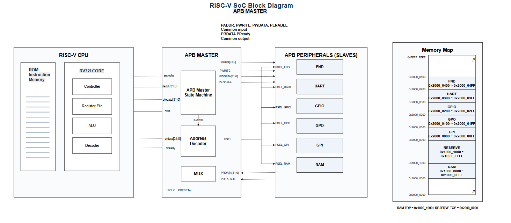
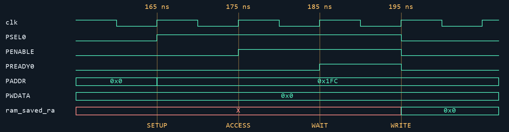

# RV32I 멀티사이클 CPU와 APB SoC

2026년 9–10월 팀 프로젝트입니다. RV32I CPU의 제어·데이터 경로를 구현하고, AMBA APB를 통해 RAM과 GPIO를 메모리 주소로 접근하도록 연결했습니다. 팀 조장으로 CPU·APB 통합과 RTL 구현에 참여했고, 어셈블리와 테스트벤치 담당자와 함께 파형에서 오류 구간을 찾고 검증 시나리오를 조율했습니다.



## 시스템 구조

```text
명령어 ROM → RV32I 제어 FSM / 데이터패스
                    ↓ Load / Store
             APB Requester
                    ↓
        주소 디코더 + 응답 MUX
             ↙      ↓      ↘
           RAM   GPI/SW   GPO/LED
```

| 주소 | 기능 |
| --- | --- |
| `0x1000_0000` | 데이터 RAM 시작 주소 |
| `0x2000_0000` / `0x2000_0004` | GPI 제어 / 스위치 입력 |
| `0x2000_0100` / `0x2000_0104` | GPO 제어 / LED 출력 |

위 맵은 **Basys3 GPIO 데모**의 주소 맵입니다. `verification/sum/`은 RAM과 어셈블리 프로그램의 흐름을 더 작게 재현하는 별도 테스트 구성입니다.

## Basys3 GPIO 데모

Vivado 2020.2, Digilent Basys3, `xc7a35tcpg236-1`을 사용합니다. 이 폴더에서 Vivado Tcl Console을 열고 프로젝트를 만듭니다.

```tcl
source create_project.tcl
```

- 합성 Top은 `rv32i_top`, 시뮬레이션 Top은 `tb_rv32i_top`입니다.
- Behavioral Simulation에서 `PASS: APB RAM and switch-to-LED test completed.`를 확인합니다.
- 보드에서는 비트스트림을 생성해 내려받고 BTNC로 초기화합니다. SW[7:0] 입력이 LED[7:0]에 반영되는 것이 데모의 정상 동작입니다.
- `rom/rom_code_apb_gpio.mem`은 Tcl이 초기화 파일로 등록합니다. 프로그램 원본은 [어셈블리 파일](software/test_apb_gpio.S)에 있습니다.

## APB 기능 검증

Windows에서 Vivado 2020.2의 `xvlog`, `xelab`, `xsim`을 PATH에 추가하고 실행합니다.

```powershell
.\verification\sum\run_xsim.cmd
```

```text
PASS: a=10 sum=55, a writes=11, sum writes=11, APB reads=81
```

테스트벤치는 RAM에 저장된 누적합의 중간값과 최종값을 비교합니다. Load는 읽기 데이터가 목적 레지스터에 반영되는 시점, Store는 RAM이 갱신되는 시점을 완료 에지와 함께 확인했습니다.

### 대기 상태 트러블슈팅

PREADY를 한 클록 늦춘 재현 조건에서 ACCESS를 먼저 종료하면 RAM 쓰기가 완료되지 않습니다. Requester가 PREADY가 올 때까지 ACCESS와 선택·주소·데이터를 유지하도록 수정했고, 같은 조건에서 195 ns 상승 에지에 RAM이 갱신되는 것을 확인했습니다. 아래 그림은 재현 시뮬레이션의 신호를 정리한 것입니다.



## PC+4 타이밍 실험

동일한 **8.000 ns** 제약에서 토대가 되는 PC+4의 캐리 경로를 비교했습니다. 리플 캐리는 음수 Slack을 재현하기 위해 의도적으로 넣은 비교 구조입니다.

| 배치배선 지표 | 실험용 리플 캐리 | 원본 덧셈 RTL |
| --- | ---: | ---: |
| Setup WNS | −0.048 ns | +5.200 ns |
| Setup 위반 종단점 | 3 | 0 |
| 최악 데이터 경로 지연 | 8.003 ns | 2.806 ns |
| 최악 경로 논리 | LUT 18단 | CARRY4 6단 |

[리플 캐리 경로](docs/timing/ripple_8.000_paths.rpt) · [원본 덧셈 경로](docs/timing/restored_8.000_paths.rpt)

PC+4 기능 동등성은 directed·random **1,034개 입력**에서 확인했습니다. Windows에서 Vivado 도구가 PATH에 있으면 `verification/pc4/run_xsim.cmd`로 실행할 수 있습니다. [시뮬레이션 기록](docs/timing/pc4_simulation.txt)

별도의 단일·멀티사이클 코어 비교는 동일한 FPGA와 20 ns 제약의 독립 벤치마크에서 수행했습니다. WNS는 각각 **+6.947 ns / +6.966 ns**, setup 기준 주기 추정치는 **13.053 ns / 13.034 ns**였습니다. 두 RTL의 레지스터 파일 구조와 명령당 사이클 수가 다르며, 이 수치는 해당 조건의 배치배선 결과입니다. [코어 비교 결과](docs/timing/results.json)

## 소스

- `rtl/`, `rom/`, `software/`, `constraints/`, `sim/` — Basys3 데모
- `verification/sum/` — 누적합 testbench와 자체 RTL 구성을 사용한 XSim 실험
- `verification/pc4/` — PC+4 기능 비교용 테스트벤치와 리플 캐리 모듈
- `docs/timing/` — 환경 경로를 정리한 기존 Vivado 보고서와 실험 기록
