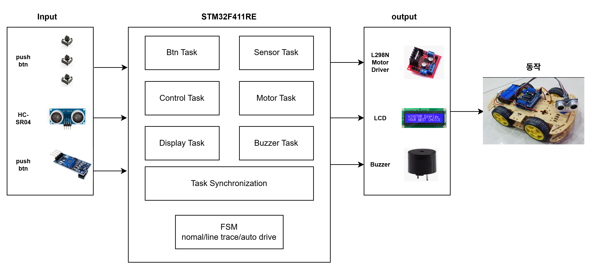
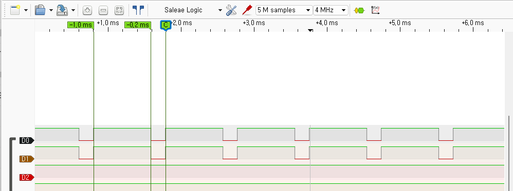

# STM32 FreeRTOS 자율주행 RC카

STM32 NUCLEO-F411RE에서 초음파 센서로 거리를 읽어 자동 주행하고, HC-06 블루투스 명령으로 수동 주행하는 프로젝트입니다. 이 폴더는 2026-11-16 AutoDrive 프로젝트에 **FreeRTOS 작업 주기 계측**을 추가한 버전입니다.



## 기술과 동작

| 블록 | 구현 범위 |
| --- | --- |
| 센서 | 초음파 센서의 Trigger·Echo, 전방·좌·우 거리 측정과 오래되거나 유효하지 않은 값 처리 |
| UART | USART6 9,600 baud, HC-06 명령 수신, UART 인터럽트와 링 버퍼 |
| 모터 | TIM3 CH1·CH3 PWM과 방향 출력, 정지 명령 및 모드별 제어 |
| FreeRTOS | Button·Bluetooth·Ultrasonic·Control·Motor 태스크, 센서 읽기에서 모터 명령까지의 상태 관리 |
| 계측 | DWT 사이클 카운터를 사용해 SRAM에 태스크 전환과 제어 실행 구간을 기록 |

```text
초음파 센서 ─┐
             ├→ ControlTask / 상태 전이 → MotorTask → TIM3 PWM
HC-06 UART ──┘
```

## STM32CubeIDE로 빌드

1. STM32CubeIDE에서 **File → Import → Existing Projects into Workspace**를 선택하고 이 폴더를 지정합니다.
2. `AutoDrive_RTOS_Timing`의 **Debug** 빌드를 실행합니다.
3. `.ioc`에서 핀과 주변장치 설정을 확인합니다. 보드 디버깅은 ST-LINK를 사용합니다.
4. 코드 재생성 시 `Core/Inc/FreeRTOSConfig.h`에서 `INCLUDE_vTaskDelayUntil`을 1로 유지해야 합니다. 계측 버전의 고정 주기 제어에서 호출합니다.

STM32CubeIDE 2.2.0에서 이 저장소용 소스를 가져와 Debug 빌드를 확인했습니다. 구조를 초기 상태에서 테스트할 때는 차량 바퀴를 지면에서 띄우고 모터 방향과 정지 입력을 먼저 확인합니다.

## PWM 측정과 RTOS 계측

- **이전 실물 PWM 기록** — 로직 애널라이저에서 주기 약 **1 ms**, 주파수 약 **1 kHz**, 해당 측정 조건의 듀티 약 **80%**를 확인했습니다. 아래 그림은 해당 테스트 캡처입니다.
- **계측 버전** — ControlTask에 `vTaskDelayUntil()`을 적용한 **10 tick** 기준 주기와 기존 상대 지연을 같은 펌웨어에서 비교할 수 있습니다. 기본 tick은 1 kHz입니다. 주기를 놓친 횟수와 작업 시작·종료도 기록합니다.
- **보드에서 확인할 지표** — 제어 태스크 시작 간격, 지연과 누락 횟수, 초음파 측정 중 태스크 선점 시점. 빌드 확인과 별개로 이 값은 보드에서 trace를 수집해 비교합니다.



GDB에서 SRAM trace를 덤프한 뒤 Python으로 변환합니다.

```powershell
python decode_rtos_trace.py rtos_trace.bin -o rtos_trace.csv
```

[기준 주기 전환, GDB 덤프, 로그 판독 절차](RTOS_Timing_README.md)

## 소스 구조

- `Core/Src/app/` — 주행 상태, 태스크, RTOS trace
- `Core/Src/driver/` — 모터, 초음파, 버튼, UART 블루투스 드라이버
- `Core/Inc/`, `Core/Startup/` — 보드 및 RTOS 초기화 설정
- `Drivers/`, `Middlewares/` — 기존 HAL·CMSIS·FreeRTOS 의존성 및 라이선스
- `decode_rtos_trace.py` — SRAM trace → CSV
